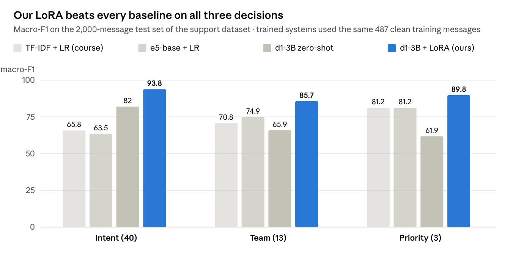
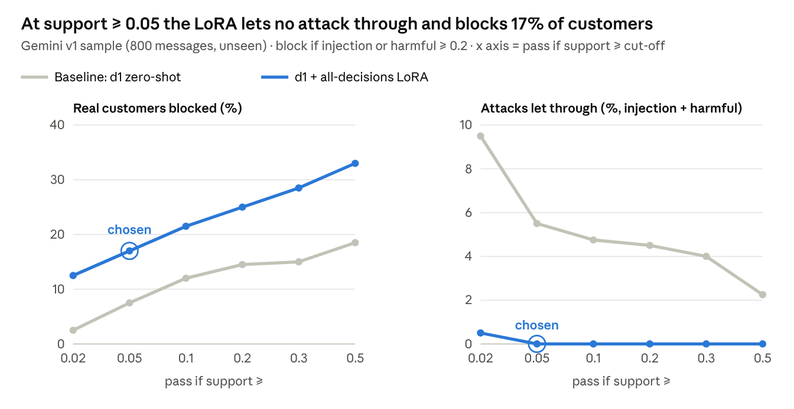
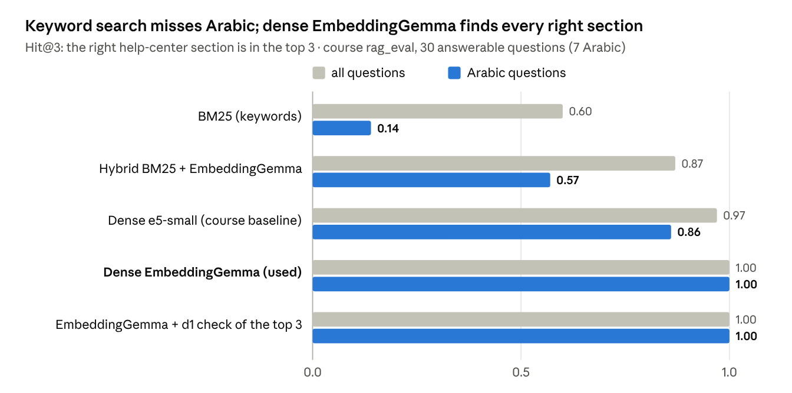
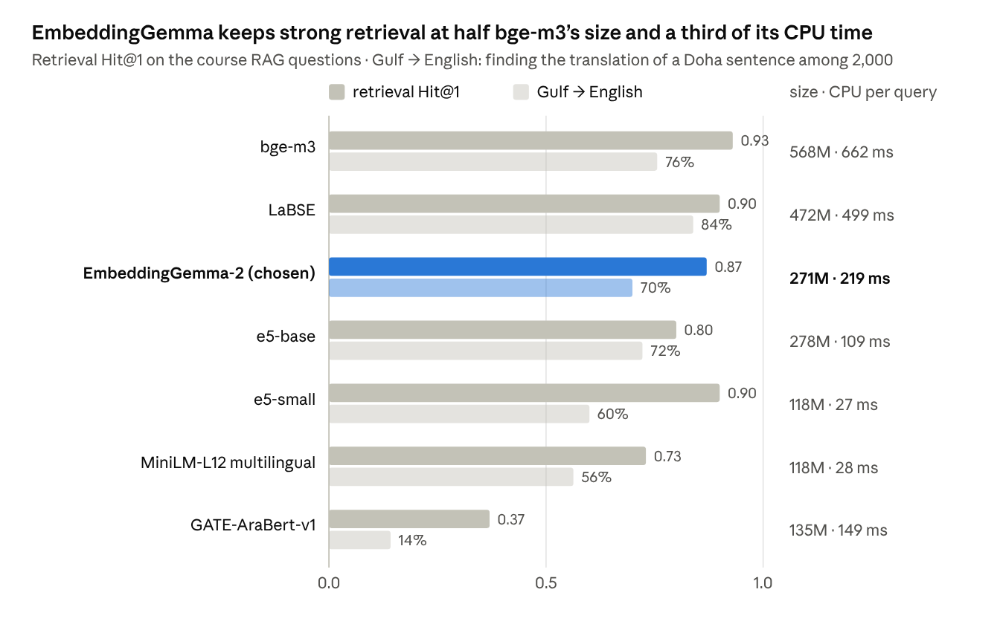
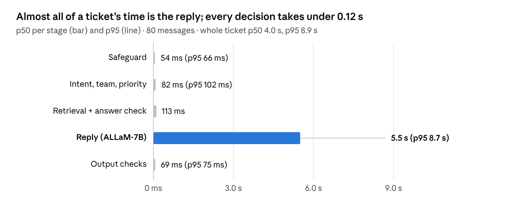

# Ticket Assistant Model Card

Oct 15, 2026 · @Mr.Stark

## Model details

The Ticket Assistant screens, classifies and answers customer-support tickets in Arabic (فصحى and Gulf dialects) and English, with one decision model and one adapter for every decision. Built for the SDAIA Academy Applied NLP capstone (Ticket Assistant use case), October 2026.


The app does not have to wait for the reply: `handle_stream` hands over each stage's result as soon as it finishes, so priority can order the queue and the team can pick the inbox about 0.15 s after a ticket arrives, while the reply is still being written.

| Component | Model | Size | Role |
| --- | --- | --- | --- |
| Decision model | [LiquidAI/d1-3B](https://huggingface.co/LiquidAI/d1-3B), fine-tuned with our LoRA merged into its weights: `runs/d1_merged_all` | 3B frozen + 24.5M LoRA weights (47 MB), 6.5 GB on GPU | safeguard, intent (40), team (13), priority (3) |
| Retriever | google/embeddinggemma-2 | 271M | finds the 4 closest help-center sections, searching with the message and a query the reply writer rewrites from it |
| Reply writer | humain-ai/ALLaM-7B-Instruct-preview, 4-bit NF4 | 7B, 5.1 GB on GPU | always drafts the reply from the 4 sections only, citing them; any OpenAI-compatible API can replace it |
| Knowledge base | course `labs/data/kb` (DemoMart help center) | 10 pages, 33 sections | the facts a reply may use |

- **How d1 decides:** each decision is a question with options written in plain text (yes/no or a choice). d1 reads the ticket and returns a probability for every option in one forward pass, so labels, teams and rules can change by editing text.
- **The LoRA:** rank 16, alpha 32, on the attention, convolution and feed-forward projections of d1's language model; loss = cross-entropy over d1's option tokens. Trained in two steps on one RTX 3090: 4.2 min on the support dataset, then 6.5 min on the support data plus the safeguard set (1,941 examples). The adapter is then merged into d1's weights (`scripts/merge_lora.py`), so the result is an ordinary model folder, `runs/d1_merged_all`, used like any other model.
- **Hardware:** the fine-tuned d1 is served by vLLM on an RTX 3090 (9.3 GB) next to EmbeddingGemma in the app (1.5 GB); ALLaM is served by vLLM on an RTX 3060 (10.2 GB). Every model loads once at start-up.

## Intended use

An assistant for a support agent of an online store: it blocks attacks and off-topic messages, labels and routes each ticket, orders a queue by priority and writes a cited reply from the help center.

- **In scope:** store-support tickets about orders, delivery, payments, refunds, returns, accounts and the store's products, in Arabic or English; queues of many tickets answered high priority first.
- **Out of scope:** sending replies without a person; legal, medical or financial advice; deciding refunds or account actions on its own; other domains without changing the scope sentence, the label lists and the knowledge base (and retraining the LoRA for best results).
- **Outputs a person acts on:** "Reply ready" (a cited answer from the help center), an "Out of scope" message listing what the store can help with, or a block with its own message (harmful request, prompt injection; the injection message never says what was detected).

## Data

The LoRA trained on 487 support messages and 160 safeguard messages; every reported number comes from data it never saw.

| Set | Made with | Size | Labels | Used for |
| --- | --- | --- | --- | --- |
| `arabic_support_natural_10000.csv` | generated with GPT-6.1 Sol | 10,000 Arabic messages, 20 varieties (Najdi, Hijazi, Gulf, فصحى ...) | 40 intents, 13 teams, 3 priorities | training: the 487 training messages with no near-copy in the test set; test: 2,000 messages (50 per intent) |
| `data/guard/guard_small.csv` | hand-written for this project | 160 messages, 40 per label, 55 in Arabic, 4 apps | in scope, out of scope, prompt injection, harmful | safeguard training |
| `guardrail_decision_dataset_5000.csv` (Gemini v1) | generated with Gemini Agron | 5,000 rows, 8 apps; 800-row sample (200 per label) | the same 4 labels | safeguard test and choice of cut-offs only |
| Course `rag_eval.csv` + `labs/data/kb` | SDAIA Academy course | 32 questions (23 English, 7 Arabic answerable; 2 unanswerable), 33 sections | the section that answers each question | retrieval test |
| 22 uncovered store questions | written for this project | 10 English, 10 Arabic + the 2 course unanswerable | none in the help center | the "can the help center answer this?" test |

**Leakage control.** The support dataset is heavily templated (94% of training messages have a near-copy in the test set), so training kept only the 487 messages whose character 3-5-gram TF-IDF cosine to every test message is below 0.6. The Gemini safeguard set was never trained on; 99% of its rows have a near-copy, so it holds about 700 to 1,800 distinct messages.

## Baseline and improvements

The baseline is zero-shot d1-3B, which already beats the course's TF-IDF baseline on intent (82.0 against 65.8); two LoRA steps add 10 to 30 points on every decision and close the safeguard's last gap.



Trained encoders beat zero-shot d1 on team and priority, which follow dataset-specific conventions; a 4.2-minute LoRA on the same 487 messages puts d1 ahead on all three.

| Step | What changed | Intent / team / priority (400-message sample) | Safeguard on Gemini v1 (800, unseen) |
| --- | --- | --- | --- |
| 1. Baseline: d1-3B zero-shot | none; labels given as text | 81.0 / 65.9 / 60.5 | 95.0% correct, 18.5% of customers blocked, 0.5% of injections and 1.0% of harmful requests through |
| 2. Support LoRA | 4.2 min on 487 support messages (1,461 examples) | 94.7 / 83.8 / 89.3 | 92.0% correct, 26.0% blocked, 4.5% injections and 1.5% harmful through |
| 3. **All-decisions LoRA (final)** | **6.5 min more on support + 160 safeguard messages (1,941 examples)** | **91.6 / 83.5 / 92.8** | **95.8% correct, 17.0% blocked, 0% injections and 0% harmful through** |

The second step trades 3 points of intent for 3.5 points of priority and a safeguard that lets no attack through while blocking fewer real customers than the baseline. Safeguard rows use each version's best setting (step 1 and 2: block ≥ 0.1, pass if support ≥ 0.5; step 3: block ≥ 0.2, pass if support ≥ 0.05).

## Configuration options

Every setting below was compared on held-out data before it was fixed; the chosen value is in bold.

| Setting | Options compared | Chosen | Why |
| --- | --- | --- | --- |
| Adapter on d1 | none · support LoRA · all-decisions LoRA | **all-decisions LoRA, always on** | best priority and the only version with 0 attacks through; one adapter for every decision |
| Safeguard questions | 2 yes/no (store support, injection) · 3 yes/no reading the app's scope (support, injection, harmful) | **3 yes/no, scope-aware** | catches harmful requests and works for any app's scope sentence |
| Block if injection or harmful ≥ | 0.1 · 0.2 · 0.3 · 0.5 · 0.7 · 0.9 | **0.2** | 0 attacks through from 0.1 to 0.2; a few pass from 0.3 |
| Pass if support ≥ | 0.02 · 0.05 · 0.1 · 0.2 · 0.3 · 0.5 | **0.05** | the lowest value with 0 attacks through (chart below) |
| Retrieval | BM25 · dense · hybrid BM25 + dense (RRF) | **dense** | BM25 shares no words with Arabic questions (Arabic Hit@3 0.57 with hybrid, 1.00 dense) |
| Embedding model | bge-m3 · LaBSE · EmbeddingGemma-2 · e5-base · e5-small · MiniLM-L12 · GATE-AraBert | **EmbeddingGemma-2** | Arabic Hit@3 1.00 at half the size of bge-m3 and 3× its CPU speed |
| "Can the help center answer this?" check | none · d1 judges 20 sections one by one · d1 judges the top 3 in one call | **top 4, one call, after the reply (top 3 and top 4 both pass 30/30 and flag 20/22)** | same Hit@3 as 20 candidates, 2.4× faster (113 ms against 269 ms); stops 20 of 22 uncovered questions |
| Answer threshold | below 0.3 → a person | **0.3** | all 30 answerable course questions pass |
| Reply model | ALLaM-7B-Instruct in 4-bit NF4 | **4-bit on the RTX 3060** | fits in 5.1 GB beside d1 on the other GPU |



Raising the support cut-off blocks more real customers for both versions; only the LoRA reaches zero attacks, from 0.05 upward. The cut-offs were chosen on this same Gemini sample, so its numbers are slightly optimistic.

## RAG metrics

The right help-center section is in the top 3 for every answerable course question, in English and Arabic (Hit@3 1.00), and the d1 check short or dialect messages are searched with a query the reply writer rewrites from them (few-shot), so "وين فلوسي" finds the refund pages. Test: the course's Lab 2.3 protocol, `rag_eval.csv` (23 English and 7 Arabic answerable questions, 2 unanswerable) over 33 help-center sections, one question at a time on the RTX 3090.





**"Can the help center answer this?" check** (22 store questions the help center does not cover, plus the 30 answerable ones)

| Setup | Made-up answers on the 22 uncovered | Uncovered stopped | Answerable passed |
| --- | --- | --- | --- |
| EmbeddingGemma top 3 → ALLaM, no check | 16 of 22 (e.g. a one-year fridge warranty, a loyalty scheme that does not exist) | 0 of 22 | 30 of 30 |
| **+ d1 + LoRA check, one call over the top 3 (used)** | **at most 2 of 22 can get a made-up answer; the other 20 get a reply that only asks for details (no help-center sections given to the AI)** | **20 of 22** | **30 of 30** |



A refused or unanswerable ticket finishes in under 0.3 s because ALLaM never runs. With 30 questions one question is 3.3 points, so the top rows are near perfect rather than precisely ranked.

## How to configure and run

All settings live in one file, `.env` in the project root; edit it and restart, no code changes needed.

**1. Install** (Python 3.12, NVIDIA GPU; the defaults use about 7.4 GB on one GPU and 5.1 GB on a second):

```bash
cd ticket-assistant
uv sync
```

**2. Create your config** by copying the template, then edit the lines you need (each line is explained in the file):

```bash
cp .env.example .env
```

**3. To use an outside API with your own key**, set the reply writer (and optionally the embedder) to `api` and give the provider's URL, key and model. Any OpenAI-compatible provider works: OpenAI, Azure OpenAI, Groq, OpenRouter, Together, or a local vLLM or Ollama server.

```bash
TA_LLM=api
TA_LLM_API_BASE=https://api.openai.com/v1
TA_LLM_API_KEY=sk-...
TA_LLM_API_MODEL=gpt-4o-mini

# optional: embeddings from an API too
TA_EMBEDDER=api
TA_EMBED_API_BASE=https://api.openai.com/v1
TA_EMBED_API_KEY=sk-...
TA_EMBED_API_MODEL=text-embedding-3-small
```

The decision model works the same way: give a link to run it in the app, or a vLLM server's URL (and key, if the server has one). It cannot use a general chat API such as OpenAI's, because d1 reads option probabilities that chat APIs do not return. `.env` is git-ignored, so keys stay out of the repository.

```bash
# decision model in the app: a link to a Hugging Face id or a local folder
TA_DECISION=local
TA_DECISION_MODEL=runs/d1_merged_all      # our fine-tuned d1; LiquidAI/d1-3B = the original

# or the same model behind a vLLM server
TA_DECISION=api
TA_DECISION_MODEL=runs/d1_merged_all      # still names the model, for its tokenizer and prompt format
TA_DECISION_API_BASE=http://127.0.0.1:18031/v1
TA_DECISION_API_KEY=                      # only if the server has one
TA_DECISION_API_MODEL=d1-ticket
```

**4. Run the web app** (One ticket and Queue tabs, every stage streamed):

```bash
uv run python -m ticketassist.web --port 7861
```

Then open `http://127.0.0.1:7861`. The page header shows which models and APIs are active.

**5. Or call the pipeline from Python:**

```python
from ticketassist.system import TicketSystem

s = TicketSystem()                      # loads the models named in .env
r = s.handle("How long does a refund to my Visa card take?")
print(r["action"], r["intent"]["priority"], r["intent"]["team"])
print(r["reply"])

# a result after every stage, the reply word by word ("وين طلبي؟" = "where is my order?")
for step in s.handle_stream("وين طلبي؟"):
    print(step["action"], step.get("reply", "")[:40])

# safeguard + decisions only, to order a queue ("حسابي اخترق" = "my account was hacked")
s.triage("حسابي اخترق")
```

Each result holds `action` (reply ready or refused), `guard`, `intent` (intent, team, priority with probabilities), `sections`, `reply`, `check` (only from `check()`, kept for evaluations) and `timings`.

**Serving with vLLM (the running setup).** Both models run as vLLM servers in Docker and the app talks to them through `.env`; the app itself only holds EmbeddingGemma and starts in about 15 s. The decision model needs three vLLM options so the app can read its option probabilities:

```bash
# decision model (RTX 3090, port 18031)
vllm serve runs/d1_merged_all --served-model-name d1-ticket --max-model-len 8192 \
  --logprobs-mode processed_logprobs --max-logprobs 400 --no-enable-prefix-caching \
  --limit-mm-per-prompt '{"image":0}' --gpu-memory-utilization 0.40

# reply writer (RTX 3060, port 18030)
vllm serve ALLaM-AI/ALLaM-7B-Instruct-preview --served-model-name allam-7b \
  --quantization fp8 --max-model-len 4096 --gpu-memory-utilization 0.88
```

The two servers run as the Docker containers `ticket-d1-vllm` and `ticket-allam-vllm` (vLLM 0.28), restart on their own after a reboot, and the web app is restarted with `scripts/start_web.sh`. Any OpenAI-compatible server (vLLM, Ollama, a cloud provider) can replace the reply writer by changing its three `TA_LLM_API_*` lines.

## Limitations and how to run

- **Synthetic data.** Both training sets and the safeguard test set are generated or hand-written; the support data is templated, so scores on real customer tickets may be lower.
- **Small safeguard training set.** 160 messages; 17% of legitimate Gemini requests are still blocked, many of them request types the app's scope sentence does not mention. More varied, balanced safeguard messages should lower this.
- **Cut-offs chosen and reported on the same Gemini sample**, so those numbers are slightly optimistic; a fresh test set no model has seen is the next check.
- **Priority and team for some intents** do not follow the dataset's fixed rule (a double charge came out Low and Order management instead of Medium and Billing); taking them from the intent with the dataset's rule table would fix it and make them immune to tone.
- **ALLaM can still add advice the help center does not contain;** with no review step, those replies are sent as written.
- **Small RAG test:** 30 answerable questions; one question is 3.3 points.

## Licenses and sources

The models carry their own licenses, and the most restrictive one is d1's: free use, including commercial use, for organisations under $10M annual revenue. Our LoRA is a derivative of d1, so the same license applies to it. Checked on each model page on 15 October 2026.

| Part | Source | License |
| --- | --- | --- |
| Decision model | [LiquidAI/d1-3B](https://huggingface.co/LiquidAI/d1-3B) | [LFM Open License v1.0](https://huggingface.co/LiquidAI/d1-3B/blob/main/LICENSE): Apache-style terms; commercial use only for organisations under $10M annual revenue (qualified non-profits exempt for research) |
| Our fine-tuned d1, LoRA merged in (`runs/d1_merged_all`) | trained in this project | a derivative of d1, so under the LFM Open License v1.0 |
| Embedder | [google/embeddinggemma-2](https://huggingface.co/google/embeddinggemma-2) | Apache 2.0 |
| Reply writer | [humain-ai/ALLaM-7B-Instruct-preview](https://huggingface.co/humain-ai/ALLaM-7B-Instruct-preview) | Apache 2.0 |
| Help center and RAG test | [SDAIAAcademy/applied-nlp](https://github.com/SDAIAAcademy/applied-nlp), `labs/data` (`kb/`, `rag_eval.csv`) | no license file in the repository; course material, used for this course project |
| Support dataset | generated with GPT-6.1 Sol | synthetic; subject to the generator's terms of use |
| Safeguard test set (Gemini v1) | generated with Gemini Agron | synthetic; subject to the generator's terms of use |
| Safeguard training set | hand-written for this project (`data/guard/guard_small.csv`) | ours |
| Project code (`ticketassist/`, `scripts/`) | this project | Apache 2.0 (`LICENSE`; `NOTICE` lists the third-party terms above) |

The course: [SDAIA Academy, Applied NLP Engineering](https://github.com/SDAIAAcademy/applied-nlp) (AI Engineering track), Ticket Assistant capstone. An outside API used as the reply writer or embedder (step 3 of "How to configure and run") adds that provider's terms.
